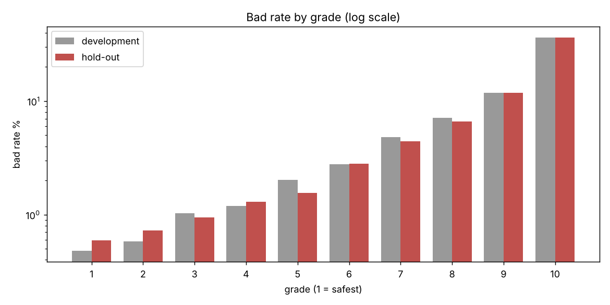
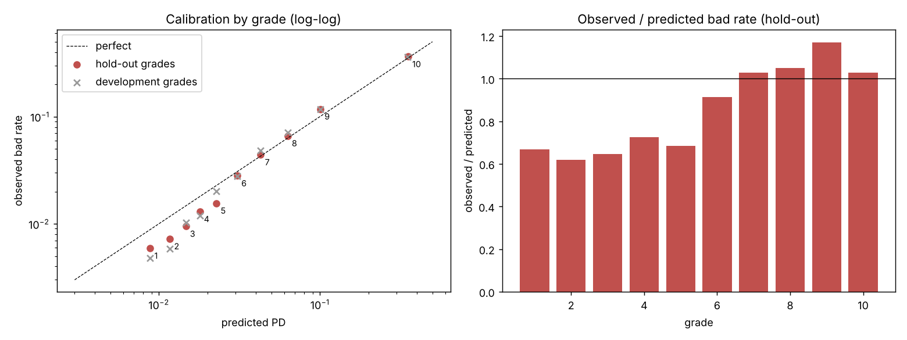

# Credit Risk PD Scorecard

An application scorecard for the **probability of default (PD)** of retail borrowers, built the way a bank model-development team would:
WoE binning, logistic regression, points-based scorecard, and a validation that separates *ranking* from *calibration*.

> Learning / portfolio project on a public dataset. **Not** a production model; not for real lending decisions.
> Limitations are stated up front in [`reports/limitations.md`](reports/limitations.md).

## Quick start

The repository is **ready to run**: the data, the scoring database and a promoted training run are committed,
so the app opens without any training.

**Option A: open the app now (about 1 minute)**

```
git clone https://github.com/vietlexuan04/Credit-Risk-Modelling.git
cd Credit-Risk-Modelling
pip install -r requirements.txt        # Python 3.13 was used
python -m streamlit run app.py         # opens http://localhost:8501
```

The app uses the committed run `runs/20261121_190905` (promoted in `runs/champion.json`) and the customer
database `data/processed/scoring.db`. Try it:

- **Score a customer**: click *Random hold-out customer* or *Random test customer*, or type an ID
  (`HO_<id>` = hold-out customer with a known outcome, `TS_<id>` = customer from Kaggle's `cs-test.csv`, no outcome).
  You can also type the values by hand.
- **Batch scoring & validation**: choose *Database: hold-out customers* to re-score all 45,012 hold-out
  customers; the app reproduces the AUC / Gini / KS of the report below. Or upload your own CSV.
- **Model report**: the run's metrics, the champion decision, figures and the Excel model report to download.

Optional login: set the environment variable `APP_PASSWORD` before starting the app.

**Option B: rebuild everything from the raw data**

```
python prepare_data.py              # 1. split + clean -> data/processed/ (dev/hold-out CSV, scoring.db, data quality Excel)
python train.py                     # 2. train scorecard, XGBoost, LightGBM -> runs/<new run_id>/ (+ model report Excel)
python train.py --promote <run_id>  #    choose the run the app uses -> runs/champion.json
python -m streamlit run app.py      # 3. scoring app
```

`prepare_data.py` takes a few seconds; `train.py` about 20 minutes (hyperparameter search). Rebuilding gives
the same scorecard (same seed and rules). A new run never replaces the committed one: the app keeps using the
promoted run until you run `--promote`.

| Script | Reads | Writes |
|---|---|---|
| `prepare_data.py` | `data/cs-training.csv`, `data/cs-test.csv` | `data/processed/`: `dev.csv`, `holdout.csv` (cleaned), `raw_*.csv`, `scoring.db` (raw records for the app), `data_quality_report.xlsx` |
| `train.py` | `data/processed/dev.csv`, `holdout.csv` | `runs/<run_id>/`: models, figures, CSV tables, `metrics.json`, `model_report_<run_id>.xlsx` |
| `train.py --promote` | `runs/<run_id>/metrics.json` | `runs/champion.json` |
| `app.py` | `runs/champion.json` (or latest run), `data/processed/scoring.db` | nothing (interactive) |

Only the outputs needed to run the app and read the results are committed. Intermediate files
(`data/processed/*.csv`, `runs/*/tables/`, notebook metrics) are re-created by the scripts and ignored by git.

The two Excel reports are the quickest way to review the work without running anything:
[`data/processed/data_quality_report.xlsx`](data/processed/data_quality_report.xlsx) and
[`runs/20261121_190905/model_report_20261121_190905.xlsx`](runs/20261121_190905/model_report_20261121_190905.xlsx).

Data: Kaggle competition [Give Me Some Credit](https://www.kaggle.com/c/GiveMeSomeCredit/data); see
[`data/README.md`](data/README.md).

## Results (hold-out set, 45,012 customers, 3,006 bad)

| Check | Result |
|---|---|
| AUC / Gini / KS | **0.860** (95% CI 0.852-0.867) / **0.719** / **0.565** |
| Development AUC / Gini / KS | 0.858 / 0.717 / 0.554 (5-fold CV AUC 0.858 +/- 0.008), so no overfitting |
| Rank ordering | bad rate rises strictly over 10 grades, **0.5% to 36%**, on both sets |
| Calibration, overall | mean PD 6.64% versus 6.68% observed; calibration slope 0.98 |
| Calibration, by grade | **safest five grades are over-predicted (observed / predicted about 0.6-0.7)**; structural; Hosmer-Lemeshow rejects |
| Remedy | grade master scale (PD per grade from development) repairs grade-level calibration; linear recalibration does not |
| Stability | score PSI 0.0005 (random split, so not informative about time) |
| Example cut-off | score >= 560 approves 79.5% of applicants at a 2.3% bad rate (6.7% without the scorecard) |

No class weights and no SMOTE are used, so the model output remains a real PD.




## Challenger models (Phase 1.5): XGBoost and LightGBM

Same split, same cleaned 10 inputs (no WoE, no derived features), no class weights; tuned by 5-fold CV on the
development set only. Hold-out results:

| Model | AUC (95% CI) | Gini | KS | Brier | Calibration slope | Bad rate at 80% approval |
|---|---|---|---|---|---|---|
| **Scorecard (champion)** | 0.860 (0.852-0.867) | 0.719 | 0.565 | 0.0502 | 0.98 | 2.34% |
| XGBoost | 0.867 (0.860-0.874) | 0.735 | 0.587 | 0.0488 | 1.02 | 2.17% |
| LightGBM | 0.867 (0.860-0.874) | 0.734 | 0.585 | 0.0488 | 1.02 | 2.21% |

- The gain of the challengers is **real but small**: +1.5 Gini points, paired-bootstrap 95% CI of the AUC gain
  [+0.0056, +0.0095]. They are also better calibrated by grade (Hosmer-Lemeshow not rejected).
- Decision rule, fixed before evaluation: replace the champion only with **at least +3 Gini points**, a CI above
  zero, a Brier score that is not worse and intact rank ordering. The gain fails the first check, so the
  **scorecard stays champion** and LightGBM / XGBoost are kept as benchmarks.
- The challengers lose about 2 Gini points from development to hold-out (the scorecard loses none).
- SHAP confirms the same drivers in all three models (utilization, 30-59 days late, age, 90+ days late).

Full tables and figures: [`notebooks/08_challenger_models.ipynb`](notebooks/08_challenger_models.ipynb), or run
`python train.py` to produce a versioned Excel model report in `runs/<run_id>/`. To score customers, see the
[Quick start](#quick-start).

## What was built

| Step | Notebook | Content |
|---|---|---|
| 1 | `01_data_understanding` | structure, target definition (90+ days past due within 2 years), anomalies, target-free |
| 2 | `02_train_holdout_split` | 70/30 stratified, duplicate-aware split of the raw data, seed 42 |
| 3 | `03_data_quality_cleaning` | evidence on the development set only, six deterministic cleaning rules, no imputation |
| 4 | `04_woe_iv_binning` | coarse classing with business-driven monotonic WoE, Information Value, stability checks |
| 5 | `05_variable_selection_logit` | IV, correlation, VIF, signs, p-values, backward elimination, `statsmodels` logit (9 variables) |
| 6 | `06_pd_scorecard` | PDO scaling (600 points at odds 50:1, PDO 20), points per bin, hand checks |
| 7 | `07_model_validation` | hold-out AUC/Gini/KS with bootstrap CI, rank ordering, calibration, master scale, PSI/CSI, cut-off table |
| 8 | `08_challenger_models` | scorecard training code + reproducibility check, XGBoost and LightGBM tuned by CV, full comparison (paired bootstrap, calibration, rank ordering, approval vs bad rate, PSI/CSI, SHAP), decision |

Logic lives in `src/` and is unit tested (`pytest tests`); notebooks call it and carry the narrative.

## Key design decisions

- **Split first, then explore.** Cleaning thresholds are justified on the development set only, and one deterministic `clean()` is applied to both sets, so nothing leaks into the hold-out.
- **No imputation.** Missing or invalid values get their own WoE bin; special codes (96/98) and absolute amounts hidden in `debt_ratio` are handled explicitly.
- **Business-driven monotonicity** of WoE (with one deliberate exception, `n_real_estate`, where a U-shape is meaningful).
- **Honest reporting.** Where the model is weak (grade-level calibration) or where a choice was influenced by seeing data, the reports say so.

## Scripts and app

A training run never changes the model used by the app: promotion is a separate, explicit step, as in a bank
where the model report is reviewed first. In the app, a raw record is cleaned with the same rules as training,
then scored and explained (scorecard points, or SHAP for the challengers).

The notebooks are the step-by-step version of the same work, with the reasoning behind every choice. They are
not needed to run the scripts.

## Repository structure

```
credit-risk-pd-model/
├── prepare_data.py        # step 1: data preparation
├── train.py               # step 2: training run + Excel model report; --promote
├── app.py                 # step 3: Streamlit app
├── src/                   # shared code imported by the scripts and the notebooks (not run directly)
│                          # data_processing, feature_engineering, modeling, scorecard, evaluation,
│                          # champion, challengers, comparison, report_excel
├── data/                  # cs-training.csv, cs-test.csv (Kaggle; see data/README.md)
│   └── processed/         # scoring.db + data_quality_report.xlsx committed; CSVs re-created by prepare_data.py
├── runs/                  # one folder per training run, never overwritten; champion.json (committed run: 20261121_190905)
├── notebooks/             # 01 ... 08, executed with outputs (step-by-step walkthrough)
├── outputs/               # written by the notebooks; committed: Phase 1 scorecard specs + figures used in the docs
├── reports/               # model_development.md, model_validation.md, limitations.md
├── tests/                 # unit tests: pytest tests
├── requirements.txt
└── README.md
```

## Reproducing the notebooks

Run them in order from the `notebooks/` folder (relative paths). Notebooks 02-03 re-create the CSVs in
`data/processed/` (not committed), so a single notebook from 03 onwards needs those run first, or `python prepare_data.py`:
```
cd notebooks
jupyter nbconvert --to notebook --execute --inplace 0*.ipynb
```
Notebooks 01-07 take about one minute; notebook 08 takes about 20 minutes (hyperparameter search).

## Main limitations (full list in `reports/limitations.md`)

- **No dates, so no out-of-time validation.** Random split only; performance over time is unknown.
- **Only approved customers** (no reject inference).
- **Dated US data**; nothing here describes Vietnamese borrowers or products.
- Four variables have IV above 0.5; plausible for bureau behaviour, but field timing cannot be verified without dates.
- Same person developed and validated; no fairness or legal review (note that `age` is a predictor).

## Roadmap

1. ~~XGBoost challenger on the same split and metrics, SHAP~~ (done: notebook 08, `train.py`).
2. ~~Streamlit scoring app reading a promoted run~~ (done: `app.py`).
3. Sensitivity checks (seeds, duplicates, bin settings).
4. Repeat the core on Lending Club with out-of-time validation, PSI/CSI over time and a monitoring run.
